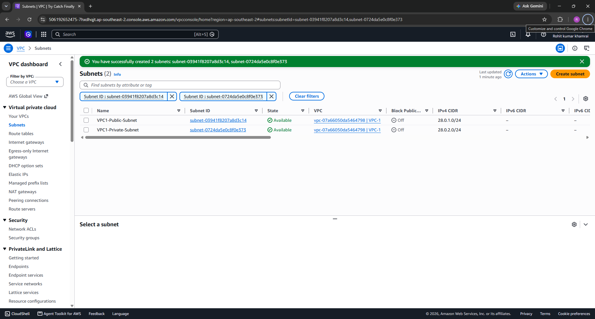
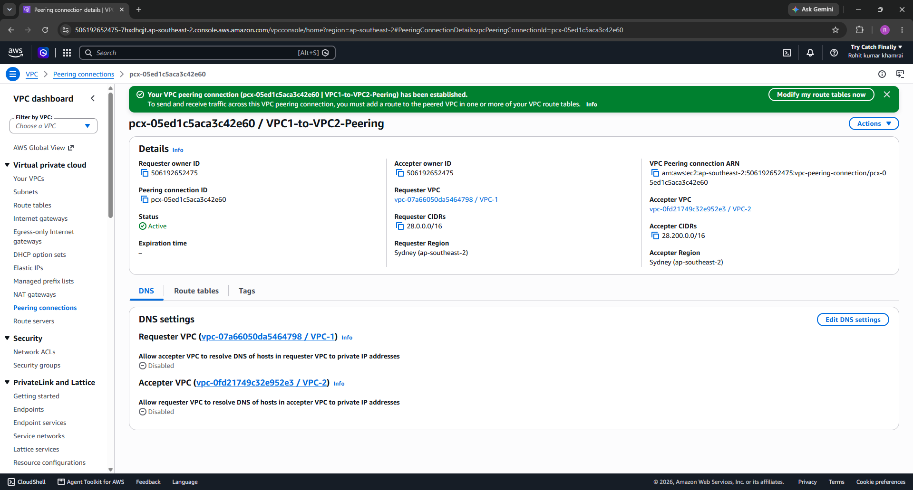
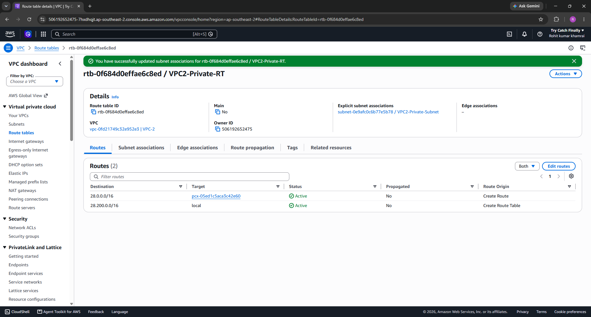
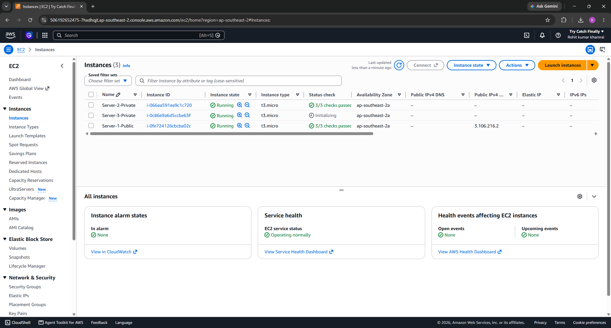
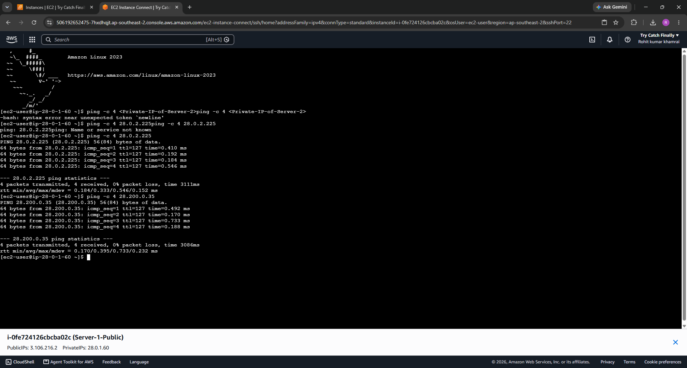

# AWS Cross-VPC Peering & Multi-Tier Subnet Architecture

[](https://aws.amazon.com/)
[](#)
[](#)

A secure, isolated multi-VPC cloud infrastructure deployed on Amazon Web Services (AWS) demonstrating cross-VPC communication via an active VPC Peering connection and custom route propagation without exposing private workloads to the public internet.

---

## 📌 Project Information

* **Project Name:** Implementation of Cross-VPC Peering with Multi-Tier Subnet Routing
* **Program:** AWS Cloud Computing Internship (Batch 1)
* **Organization:** EWB Tech Academy
* **Trainer:** Bhanu Prakash
* **Candidate:** Rohit Kumar Khamrai
* **AWS Region:** Asia Pacific (Sydney) `ap-southeast-2`
* **Documentation:** [Internship Project Report](docs/AWS_Internship_Batch1_Project_Report_Rohit_Kumar_Khamrai.pdf)

---

## 📐 Architecture Diagram

```text
                    [ Internet / Administrator ]
                                 │
                                 │  (Port 22 SSH)
                                 ▼
┌───────────────────────── VPC 1 (28.0.0.0/16) ─────────────────────────┐
│                                                                       │
│   ┌───────────────────────────┐         ┌─────────────────────────┐   │
│   │ VPC1-Public-Subnet        │         │ VPC1-Private-Subnet     │   │
│   │ CIDR: 28.0.1.0/24         │         │ CIDR: 28.0.2.0/24       │   │
│   │                           │         │                         │   │
│   │ • Server-1-Public         │         │ • Server-2-Private      │   │
│   │   Private: 28.0.1.60      │         │   Private: 28.0.2.225   │   │
│   │   Public:  3.106.216.2    │         │                         │   │
│   │ • Internet Gateway (IGW)  │         │                         │   │
│   └─────────────┬─────────────┘         └────────────┬────────────┘   │
└─────────────────┼────────────────────────────────────┼────────────────┘
                  │                                    │
                  │   VPC Peering Connection           │
                  │   (pcx-05ed1c5aca3c42e60)          │
                  ▼                                    ▼
       ┌────────────────────────────────────────────────────────┐
       │                 VPC 2 (28.200.0.0/16)                  │
       │                                                        │
       │  ┌──────────────────────────────────────────────────┐  │
       │  │ VPC2-Private-Subnet                              │  │
       │  │ CIDR: 28.200.0.0/24                              │  │
       │  │                                                  │  │
       │  │ • Server-3-Private                               │  │
       │  │   Private: 28.200.0.35                           │  │
       │  └──────────────────────────────────────────────────┘  │
       └────────────────────────────────────────────────────────┘
```

---

## 🛠️ Network & Resource Specifications

| Resource | Scope / VPC | CIDR / Subnet | Role & Association |
| :--- | :--- | :--- | :--- |
| **VPC-1** | `vpc-07a66050da5464798` | `28.0.0.0/16` | Primary VPC |
| **VPC1-Public-Subnet** | VPC-1 | `28.0.1.0/24` | Attached to IGW, hosts Bastion host |
| **VPC1-Private-Subnet** | VPC-1 | `28.0.2.0/24` | Isolated backend subnet |
| **VPC-2** | `vpc-0fd21749c32e952e3` | `28.200.0.0/16` | Remote target VPC (No IGW) |
| **VPC2-Private-Subnet** | VPC-2 | `28.200.0.0/24` | Fully private subnet |
| **Internet Gateway** | VPC-1 | `igw-0ab6771d9c9d6f758` | Ingress/egress for public subnet |
| **VPC Peering Link** | Cross-VPC | `pcx-05ed1c5aca3c42e60` | Encrypted AWS backbone routing |

---

## 🚀 Routing Table Configurations

### VPC-1 Public Route Table (`rtb-0dc5536601fd48d4d`)
* `28.0.0.0/16` → `local`
* `0.0.0.0/0` → `igw-0ab6771d9c9d6f758` *(Internet access)*
* `28.200.0.0/16` → `pcx-05ed1c5aca3c42e60` *(Targeting VPC 2)*

### VPC-2 Private Route Table (`rtb-0f684d0effae6c8ed`)
* `28.200.0.0/16` → `local`
* `28.0.0.0/16` → `pcx-05ed1c5aca3c42e60` *(Return route targeting VPC 1)*

---

## 🖥️ Compute Instances (Amazon Linux 2023)

* **Server-1-Public (`i-0fe724126cbcba02c`):**
  * Public IP: `3.106.216.2` | Private IP: `28.0.1.60`
  * Security Group: Allows SSH (22) and ICMP IPv4 from `0.0.0.0/0`.
* **Server-2-Private (`i-066ea591ee9c1c720`):**
  * Private IP: `28.0.2.225` (No public IP)
  * Security Group: Allows SSH and ICMP from `28.0.0.0/16`.
* **Server-3-Private (`i-0c86e9a6d5ccbe63f`):**
  * Private IP: `28.200.0.35` (No public IP)
  * Security Group: Allows SSH and ICMP from `28.0.0.0/16` via VPC Peering.

---

## 🧪 Verification & Diagnostic Evidence

Logged in via EC2 Instance Connect to `Server-1-Public` (`28.0.1.60`) and validated ICMP echo packets.

### 1. Intra-VPC Communication (Public Subnet to Private Subnet)
```bash
[ec2-user@ip-28-0-1-60 ~]$ ping -c 4 28.0.2.225
PING 28.0.2.225 (28.0.2.225) 56(84) bytes of data.
64 bytes from 28.0.2.225: icmp_seq=1 ttl=127 time=0.410 ms
64 bytes from 28.0.2.225: icmp_seq=2 ttl=127 time=0.192 ms
64 bytes from 28.0.2.225: icmp_seq=3 ttl=127 time=0.184 ms
64 bytes from 28.0.2.225: icmp_seq=4 ttl=127 time=0.546 ms

--- 28.0.2.225 ping statistics ---
4 packets transmitted, 4 received, 0% packet loss, time 3111ms
rtt min/avg/max/mdev = 0.184/0.333/0.546/0.152 ms
```
✅ **Status:** PASSED (0% packet loss).

### 2. Cross-VPC Peering Communication (Across Peering Connection to VPC 2)
```bash
[ec2-user@ip-28-0-1-60 ~]$ ping -c 4 28.200.0.35
PING 28.200.0.35 (28.200.0.35) 56(84) bytes of data.
64 bytes from 28.200.0.35: icmp_seq=1 ttl=127 time=0.492 ms
64 bytes from 28.200.0.35: icmp_seq=2 ttl=127 time=0.170 ms
64 bytes from 28.200.0.35: icmp_seq=3 ttl=127 time=0.733 ms
64 bytes from 28.200.0.35: icmp_seq=4 ttl=127 time=0.188 ms

--- 28.200.0.35 ping statistics ---
4 packets transmitted, 4 received, 0% packet loss, time 3086ms
rtt min/avg/max/mdev = 0.170/0.395/0.733/0.232 ms
```
✅ **Status:** PASSED (0% packet loss, 0.395 ms average round-trip time).

---

## 📷 Implementation Screenshots

### 1. VPC Subnets Provisioned


### 2. Active VPC Peering Connection


### 3. Cross-VPC Routing Table (VPC-2)


### 4. Running EC2 Instances


### 5. Terminal Network Diagnostics


---

## 🛡️ Key Security Takeaways

1. **Zero Internet Footprint:** Private workloads (`Server-2-Private` and `Server-3-Private`) possess no public IP addresses and remain inaccessible from the public internet.
2. **Strict Firewall Boundaries:** Security groups restrict inbound traffic to authorized internal subnets (`28.0.0.0/16`).
3. **Private Encrypted Backbone:** All traffic between `VPC-1` and `VPC-2` routes entirely over AWS's private network infrastructure without traversals through the public internet.
